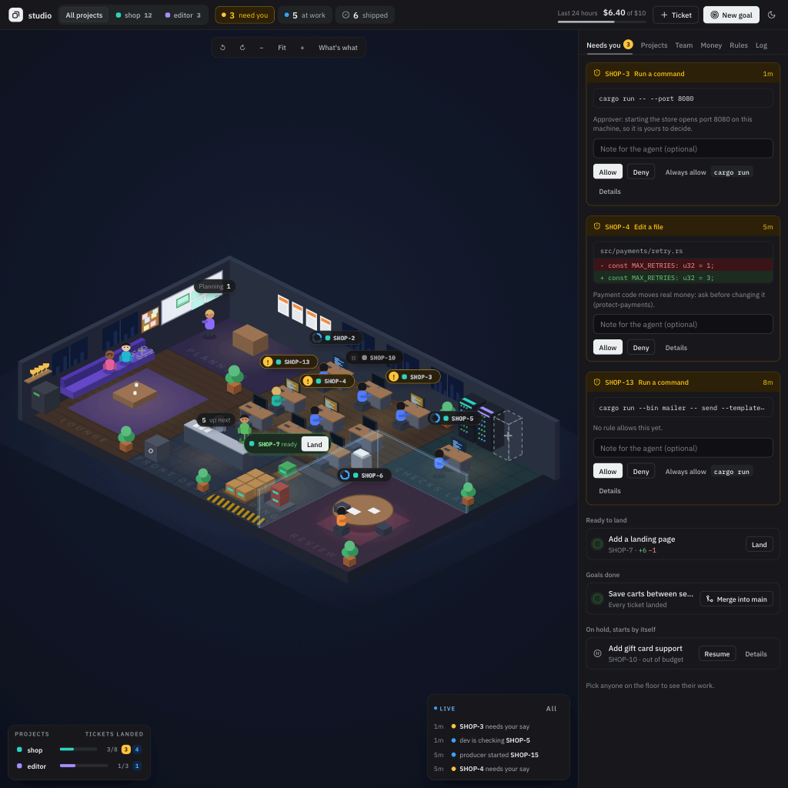
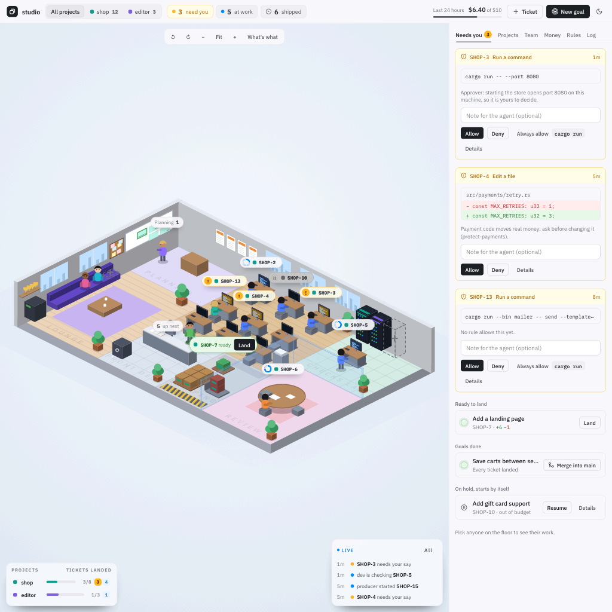
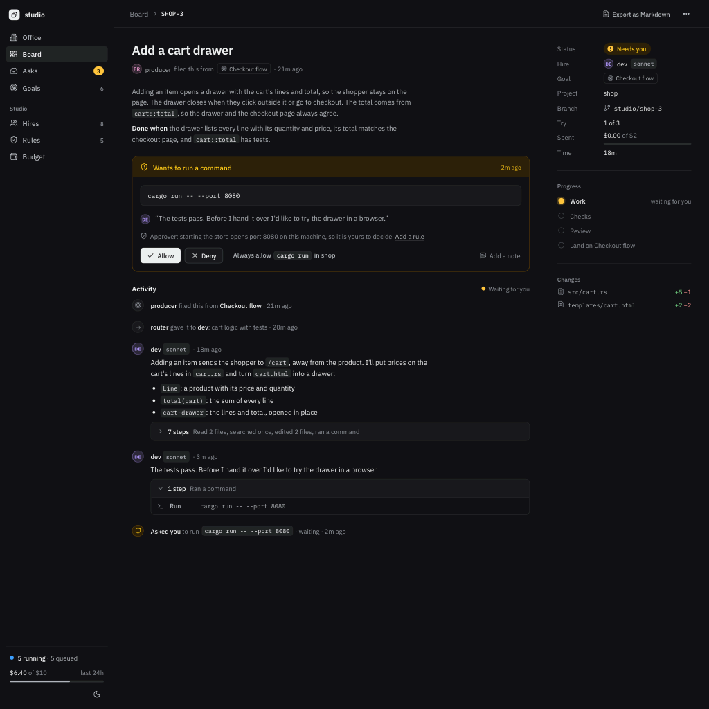

<h1 align="center">studio</h1>

<p align="center">
  <b>Run a small team of AI agents on your projects, on your machine, within a budget and your rules.</b>
</p>

<p align="center">
  <a href="https://github.com/marmolabs/studio/actions/workflows/ci.yml"></a>
  <a href="LICENSE"></a>
  
  
  
</p>

> [!WARNING]
> **Very early. Use with caution.** studio is a young project that runs AI
> agents with real tools on your repositories. Expect bugs, breaking changes
> between versions and rough edges. Try it on a repo you have backed up, keep
> its budget limits low, set a spending limit in your Claude account too, and
> read what it lands before you merge. The web UI in particular is rough and
> is being reworked.

<p align="center"></p>

studio is a local orchestrator for AI coding agents on your repos. You give it
a goal. A producer agent splits the goal into tickets; engineers work on them
with Claude Code, each in its own git worktree; your checks run; a reviewer on
a different model reads the diff; critics judge screenshots and design. The work
lands on a goal branch for you to merge. Nothing is pushed, and agents never
see your credentials.

It is built for one owner running a studio of agents all day: you set the
budget and the rules, answer the few questions that really need you, and merge
what you like.

## How it works

```text
 goal ──▶ producer ──▶ tickets ──▶ engineer ──▶ checks ──▶ critics ──▶ reviewer ──▶ goal branch ──▶ you merge
                         │            │
                         │            └─ asks ─▶ approver ─▶ (only the dangerous ones) ─▶ you
                         └─ router picks the hire
```

- **Tickets** have a clear life cycle (queued, working, checking, reviewing,
  ready, landed) and each runs in its own worktree and branch. A ticket that
  fails checks or review goes back to its agent, up to three attempts, and can
  escalate to a stronger model.
- **Goals** keep related tickets on one branch, run them in order, and let
  each build on the last.
- **Budgets** for the studio, project, hire, ticket and run. A run only starts
  if its allowance fits under all of them; a held ticket resumes by itself
  when there is room again.
- **Rules** are Markdown files: protect paths, gate commands, lint changes,
  require checks, guide the agent, or add review criteria. The studio can draft
  new rules from what you deny and send back.
- **An approver** (a cheap model) decides the tool calls no rule covers, so
  only dangerous or irreversible ones reach you. **A router** picks the right
  hire for each ticket.
- **Critic gates** send changes to a critic hire before review, with
  screenshots from your project and changed images beside their shipped version.
- **Packs** bundle hires, rules, skills and a project template to reuse across
  projects. See [packs](docs/packs.md).

## The web UI

A local web UI opens on the Office: the whole studio as one isometric floor on
a single page. Tickets sit at their desks, in the checks lab, in review and
ready to land, goals are on the whiteboard, idle hires are in the lounge, and
the approver and router stand at the front desk. A bar on top shows what needs
you, what is at work, what shipped in the last day and what you have spent,
with a strip of projects to focus on one. Everything on the floor is a control: pick it to
see it in the panel beside the floor and act there, whether that is answering
an ask, landing a ticket, merging a goal, resuming or cancelling work, hiring,
or giving a hire a ticket. The panel's tabs hold the lists: Needs you,
Projects, Team, Money, Rules and Log.

- **Desks** are how many agents work at once, up to nine; add or remove one.
- **The coffee machine** closes or reopens the office. While it is closed,
  nothing new starts.
- **The safe** holds the budget: the daily and per-ticket limits, which you can
  change.
- **The racks** show each project's checks.
- **The whiteboard** lists goals; **the team board** is where you hire;
  **the posters** are the house rules.
- **The trophies** come from the studio's history, and each hire's level grows
  with the work it has landed.
- **The lounge** shows who is free, **the front desk** the approver and router,
  **the review room** the reviewers and critics, and **the dock** what shipped
  in the last day and what came back failed.

Turn the view with the arrows or Q and E to see the office from each corner,
and drag to move around when zoomed in. A new studio starts as a bare room:
add a project at the free rack in the checks lab and hire at the free seat in
the lounge, and the floor grows with what you add, a rack for each project, a
poster for each rule, a card for each hire and a cup for each trophy.

Open `/?tab=money` for a tab, or `/?sel=tickets/<id>` for one ticket, to link
straight to it. The board, goals, asks, budget, hires and rules pages hold the
lists and the detail, and each ticket has a live activity feed. On a phone the
panel follows the floor.

<p align="center">
  
  
</p>

## Install

From a release (checks `SHA256SUMS`, installs to `~/.local/bin`, never uses `sudo`):

```sh
curl -fsSL https://raw.githubusercontent.com/marmolabs/studio/master/install.sh | sh
```

With Cargo:

```sh
cargo install --locked --git https://github.com/marmolabs/studio studio studiod studio-web
```

## Quickstart

```sh
studio init                         # studio.toml, starter hires and rules
studio project add ~/code/my-app    # register a git repo
studio up                           # start the studio and open the web UI
```

Then give it work:

```sh
studio goal -p my-app "Add a dark mode with a switch in settings"
studio ticket -p my-app "Fix the login timeout"   # the router picks the hire
```

Answer asks from the web UI or `studio asks`, and merge a finished goal with
`studio merge`. See [getting started](docs/getting-started.md).

## Requirements

- macOS or Linux. Windows is not supported: the daemon uses a Unix socket.
  The Linux release builds need glibc 2.34 or newer (Ubuntu 22.04, Debian 12,
  RHEL 9 or later).
- The [Claude Code](https://claude.com/claude-code) CLI (`claude`), installed
  and logged in. The studio runs it with your login and never reads your
  credentials.
- `git`. Optional: `gh`, to turn failing CI on your integration branch into tickets.
- Rust 1.98 or newer to build from source.

## Docs

- [Getting started](docs/getting-started.md)
- [Concepts](docs/concepts.md)
- [Configuration](docs/configuration.md)
- [Packs](docs/packs.md)
- [Security](docs/security.md)
- [Contributing](CONTRIBUTING.md) and [Changelog](CHANGELOG.md)

## Status

0.1.0, very early: use with caution (see the warning at the top). Expect
bugs and breaking changes, and a web UI that is still rough and being
reworked. Claude Code is the only agent runtime for now. The studio is largely
built by itself: this repo is one of its projects.

## License

MIT. See [LICENSE](LICENSE).
