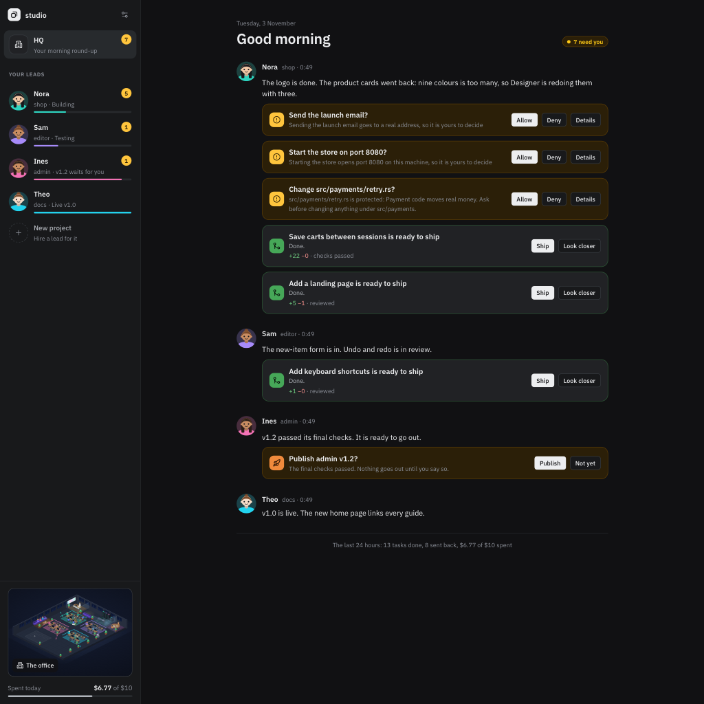
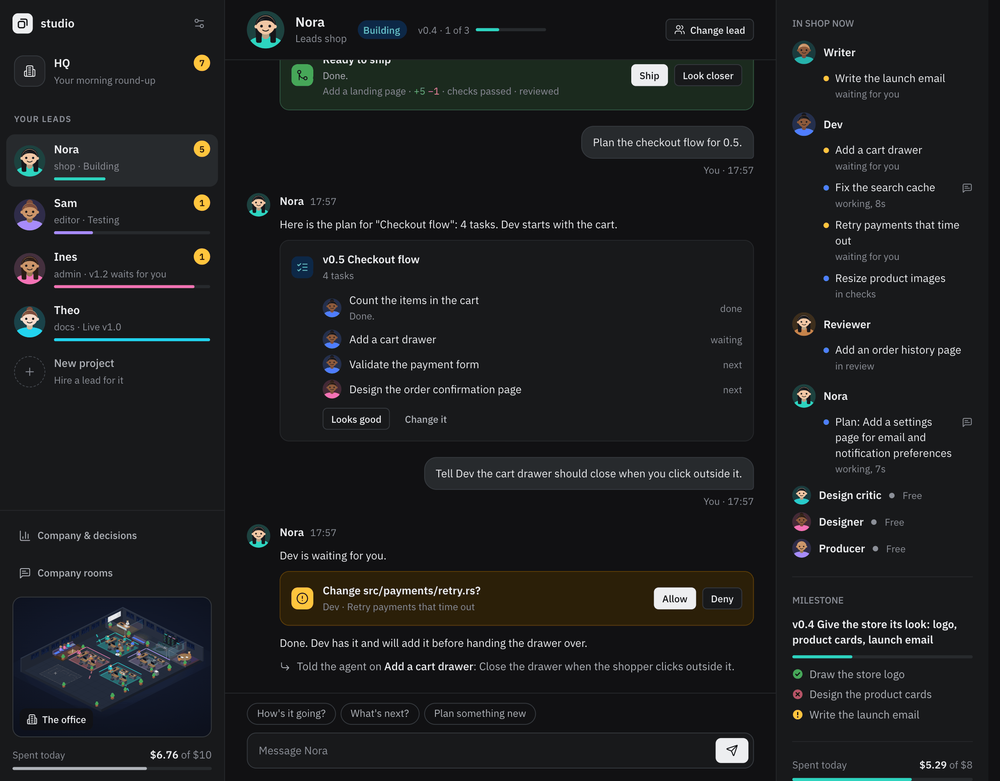

<h1 align="center">studio</h1>

<p align="center">
  <b>Run your projects like a company of AI coding agents, on your machine, within a budget and your rules.</b>
</p>

<p align="center">
  <a href="https://github.com/marmolabs/studio/actions/workflows/ci.yml"></a>
  <a href="LICENSE"></a>
  
  
  
</p>

studio is a local orchestrator for AI coding agents, run like a small company.
You are the owner. Each project has a lead: an agent you talk to. The lead
plans the project's goals, hands the tasks to its makers, checks what comes
back and comes to you only for what it can't decide. Each maker takes one task
in its own git worktree, runs your checks and leaves the result on a branch for
you to ship. Nothing is pushed, and agents never see your credentials.

> [!WARNING]
> **Very early. Use with caution.** studio runs AI agents with real tools on
> your repositories. Expect bugs and breaking changes between versions. Try it
> on a repo you have backed up, keep its budget low, set a spending limit in
> your Claude account too, and read what it ships before you do.

<p align="center"></p>

## Talk to your leads

The web UI is a team sidebar and a page for each thing you do.

<p align="center"></p>

- **HQ** is your morning round-up and approval inbox. Each lead has a line, its
  standup in a sentence or two, and under it the cards that wait for you: a
  question, a manager's proposed action, work that is ready to ship, or a
  release that wants your go-ahead. Leads with something for you come first.
  Company activity shows the last 24 hours across every project, with links to
  each person and task.
- **A lead's page** is a conversation. Ask "How's it going?", or say "Plan the
  checkout flow for 0.5" or "Tell Dev to close the drawer on outside clicks".
  The lead reads the project, answers in plain words, and can start a goal,
  send a task back, pause, resume or cancel one, and message a running agent.
  Each thing it does shows as a card. A rail beside the thread shows who is at
  work, the milestone and what the project spent today. From a terminal, use
  `studio talk my-app "How's it going?"`; without text it shows the last
  messages. A project that has no lead (HQ says so, with a link) has a card
  in place of the message box: hire a lead for it, or pick one you have. Change
  lead in the header picks another, hires a new one, or leaves it with none.
- **An employee's page** is a persistent, read-only conversation with any hire.
  Ask about their assignments and recent results, with their current and recent
  work beside the thread. An active task has a separate control to message its
  live run.
- **Company and project rooms** are persistent group conversations for
  announcements and cross-team requests. Mention a hire as `@dev` to get a
  read-only reply; plain announcements start no model run.
- **The company page** is a live map of goals, owned tasks, blockers, next steps
  and spend, with a delivery scorecard, employee workload and the manager
  decision log. Tasks have priorities and dependencies; the dependency graph
  shows what must land first and the critical path through open work.
- **Look closer** opens ready work over the conversation: a summary, the checks,
  the review, whether protected paths were touched, screenshots and clips, the
  files with their diffs and the branch to try. **Ship to main**, or **Send back
  with a note**. A goal is checked as a whole before it ships.
- **The office** is the company floor. Pick a sign for its lead, or a person or
  their task for that employee's own card and conversation. **Studio** has the
  money limits, desks, hires, rules, office pause, manager autonomy controls,
  and a simulation/live switch. Simulation gives conversations, rooms,
  standups, setup and reviews scripted replies at no model cost, while coding
  work and approvals always use real models. Automatic reviews are off by
  default. In Autonomous mode a lead may start at most 3 goals or tasks a day
  per project on its own. Cancelling, shipping and publishing always need you.

Adding a project is a conversation too: **New project** takes a folder and
hires a lead for it. The lead reads the repository and shows how the project
would run, with the checks it proposes already tried in a fresh checkout. Use
them, change something, or see the file it would write.

A message to a lead costs about $0.10 to $0.25 on a strong model, is capped at
$0.50, and counts against the project's daily limit.

## Install

You need macOS or Linux (not Windows), `git`, and the
[Claude Code](https://claude.com/claude-code) CLI (`claude`), installed and
logged in. The studio runs it with your login and never reads your credentials.

From a release (checks `SHA256SUMS`, installs to `~/.local/bin`, never uses
`sudo`):

```sh
curl -fsSL https://raw.githubusercontent.com/marmolabs/studio/master/install.sh | sh
```

Or from source, with Rust 1.98 or newer:

```sh
cargo install --locked --git https://github.com/marmolabs/studio studio studiod studio-web
```

## Quick start

```sh
studio init       # studio.toml, five hires, two rules
studio up         # start the daemon and open the web UI
```

In the web UI, choose **New project**, give the folder of a git repository and
a lead, and talk to the lead from there. Or from a terminal:

```sh
studio project add ~/code/my-app       # register a git repo
studio lead my-app manager             # name its lead (a hire)
studio talk my-app "Plan a dark mode with a switch in settings"
studio status                          # what the studio is doing
```

Answer questions with `studio asks`, `studio approve` and `studio deny`, land a
ready task with `studio land <task>` and ship a goal with `studio merge <task>`.
To release, list the commands in the project's `.studio.toml`, run
`studio release my-app 0.4`, then `studio release approve my-app`.
[Getting started](docs/getting-started.md) walks through it, including how to
write a lead's hire file.

## How it works

- **Leads** are hires you name for a project. A lead answers you, plans the
  project's goals, assigns its tasks and decides the routine tool calls its
  team asks about. Without one, a producer, a router and an approver do those
  jobs, and there is nobody to talk to.
- **Goals** are planned into **tasks** that run one after another on one goal
  branch, each in its own worktree. **Hires** are agent roles written as
  Markdown files: a model, a prompt and optional limits.
- **Rules** are Markdown files too: protect paths, gate commands, lint
  changes, require checks or guide the agent. The lead (or the approver)
  decides the tool calls no rule covers, so only dangerous ones reach you.
- **Checks and review.** The project's checks run, critics judge screenshots
  and design where a gate asks, then a reviewer on a different model reads the
  diff. A task that fails goes back to its agent, up to three tries. When every
  task of a goal is done, the checks run again on the goal's branch.
- **Shipping.** A task that passes waits for you to ship it to its goal branch
  (or ships by itself with `auto_land`), and you ship the goal into your own
  branch when you like it.
- **Releases.** The final checks run, the release waits for your go-ahead, the
  project's release commands run with `VERSION` set, and the commit is tagged
  `v<version>`. The tag is never pushed.
- **Budgets** cap the studio, a project, a hire, a task and a run. **Packs**
  bundle hires, rules and a project template to reuse.

## Docs

- [Getting started](docs/getting-started.md)
- [Concepts](docs/concepts.md)
- [Configuration](docs/configuration.md) and [Rules](docs/rules.md)
- [Packs](docs/packs.md)
- [Security](docs/security.md)
- [Contributing](CONTRIBUTING.md) and [Changelog](CHANGELOG.md)

## Status

0.1.0, very early: expect bugs, rough edges and breaking changes. Claude Code
is the only agent runtime for now. Linux release builds need glibc 2.34 or newer.

## License

MIT. See [LICENSE](LICENSE).
