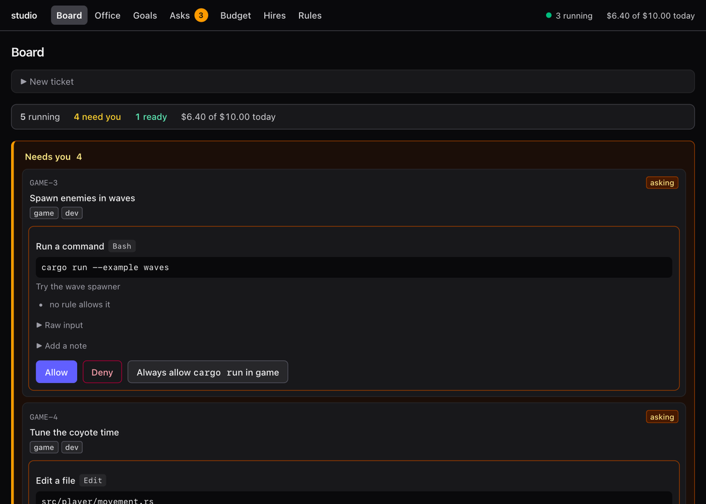

<h1 align="center">studio</h1>

<p align="center">
  <b>Run a small team of AI agents on your game, on your machine, within a budget and your rules.</b>
</p>

<p align="center">
  <a href="https://github.com/marmolabs/studio/actions/workflows/ci.yml"></a>
  <a href="LICENSE"></a>
  
  
</p>

<p align="center"></p>

studio is a local orchestrator for AI coding agents on game repos. You give it
a goal. A producer agent splits the goal into tickets; engineers work on them
with Claude Code, each in its own git worktree; your checks run; a reviewer on
a different model reads the diff; critics judge art and screenshots. The work
lands on a goal branch for you to merge. Nothing is pushed, and agents never
see your credentials.

It is built for one owner running a studio of agents all day: you set the
budget and the rules, answer the few questions that really need you, and merge
what you like.

## How it works

```text
 goal ──▶ producer ──▶ tickets ──▶ engineer ──▶ checks ──▶ critics ──▶ reviewer ──▶ goal branch ──▶ you merge
                         │            │
                         │            └─ asks ─▶ approver ─▶ (only the dangerous ones) ─▶ you
                         └─ router picks the hire
```

- **Tickets** have a clear life cycle (queued, working, checking, reviewing,
  ready, landed) and each runs in its own worktree and branch. A ticket that
  fails checks or review goes back to its agent, up to three attempts, and can
  escalate to a stronger model.
- **Goals** keep related tickets on one branch, run them in order, and let
  each build on the last.
- **Budgets** for the studio, project, hire, ticket and run. A run only starts
  if its allowance fits under all of them; a held ticket resumes by itself
  when there is room again.
- **Rules** are Markdown files: protect paths, gate commands, lint changes,
  require checks, guide the agent, or add review criteria. The studio can draft
  new rules from what you deny and send back.
- **An approver** (a cheap model) decides the tool calls no rule covers, so
  only dangerous or irreversible ones reach you. **A router** picks the right
  hire for each ticket.
- **Critic gates** send changes to a critic hire before review, with
  screenshots from your game and changed images beside their shipped version.
- **Packs** bundle hires, rules, skills and a project template, such as
  [`packs/bevy-ios`](packs/bevy-ios).

## The web UI

A local web UI shows the board, a live run log for every ticket, the asks
inbox, goals, budget, hires and rules, and an office where you can watch your
hires at their desks.

<p align="center">
  
  
</p>

## Install

From a release (checks `SHA256SUMS`, installs to `~/.local/bin`, never uses `sudo`):

```sh
curl -fsSL https://raw.githubusercontent.com/marmolabs/studio/main/install.sh | sh
```

With Cargo:

```sh
cargo install --git https://github.com/marmolabs/studio studio studiod studio-web
```

## Quickstart

```sh
studio init                         # studio.toml, starter hires and rules
studio project add ~/games/my-game  # register a git repo
studio up                           # start the studio and open the web UI
```

Then give it work:

```sh
studio goal -p my-game "Add a pause menu with resume and quit"
studio ticket -p my-game "Fix the jump buffer"   # the router picks the hire
```

Answer asks from the web UI or `studio asks`, and merge a finished goal with
`studio merge`. See [getting started](docs/getting-started.md).

`examples/starter-2d` is a small Bevy game you can point the studio at to try it.

## Requirements

- macOS or Linux. Windows is not supported: the daemon uses a Unix socket.
- The [Claude Code](https://claude.com/claude-code) CLI (`claude`), installed
  and logged in. The studio runs it with your login and never reads your
  credentials.
- `git`. Optional: `gh`, to turn failing CI on your main branch into tickets.
- Rust 1.98 to build from source (pinned in `rust-toolchain.toml`).

## Docs

- [Getting started](docs/getting-started.md)
- [Concepts](docs/concepts.md)
- [Configuration](docs/configuration.md)
- [Packs](docs/packs.md)
- [Security](docs/security.md)
- [Contributing](CONTRIBUTING.md) and [Changelog](CHANGELOG.md)

## Status

0.1.0, early. Expect breaking changes. Claude Code is the only agent runtime
for now. The studio is largely built by itself: this repo is one of its
projects.

## License

MIT. See [LICENSE](LICENSE).
